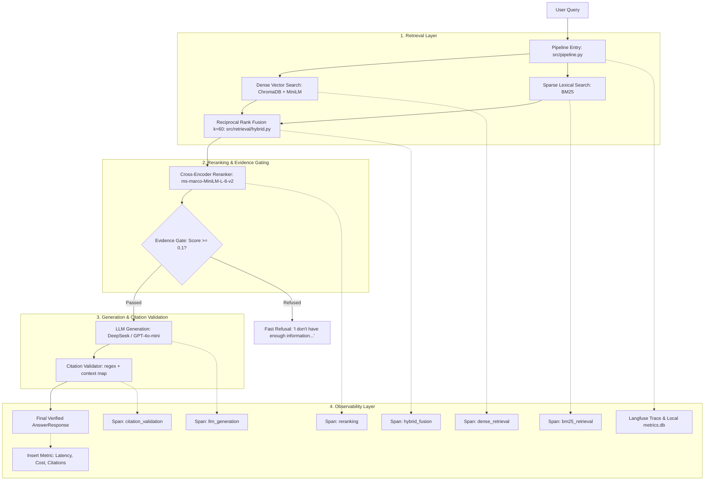

# DocuRAG: Production Hybrid RAG & Observability Engine

[](https://www.python.org/downloads/)
[](https://fastapi.tiangolo.com)
[](https://www.trychroma.com/)
[](https://langfuse.com/)
[](https://github.com/adityajha2118/DocuRAG/actions)
[](https://opensource.org/licenses/MIT)

> **DocuRAG** is a production-grade Retrieval-Augmented Generation (RAG) system engineered to answer complex technical documentation queries with zero hallucinations, strict evidence gating, and verifiable citations.

---

## 📌 Executive Summary

Modern LLMs struggle with technical documentation: they frequently confuse syntax across library versions, hallucinate function signatures, and generate plausible-sounding but fictitious URLs.

**DocuRAG solves this by combining:**
1. **Hybrid Retrieval**: Dense semantic vector search + Sparse lexical BM25 fused via Reciprocal Rank Fusion ($k=60$).
2. **Cross-Encoder Reranking**: Pointwise re-scoring using `ms-marco-MiniLM-L-6-v2` to prioritize high-precision context chunks.
3. **Evidence Gating**: Pre-generation hard gate that short-circuits out-of-domain or low-confidence queries before invoking the LLM—saving API costs and preventing hallucinations.
4. **Application-Owned Citations**: The LLM emits contextual chunk IDs `[chunk_id]` which the application validates and maps back to source URLs, preventing link hallucination.
5. **Full-Stack Observability**: End-to-end tracing via self-hosted Langfuse and a lightweight local SQLite metrics dashboard for tracking P50/P95 latency, cost, and citation validity in CI/CD.

👉 **Looking for architectural trade-offs, elevator pitches, and interview prep?** Check out [`PROJECT_DEEP_DIVE.md`](PROJECT_DEEP_DIVE.md).

---

## 🏗️ Architecture



---

## ⚡ Key Engineering Decisions

| Decision | Alternative Considered | Why DocuRAG Made This Choice |
|---|---|---|
| **Hybrid (Dense + BM25)** | Dense-only (Vector Search) | Dense embeddings capture semantics but miss exact code identifiers (e.g. `nn.CrossEntropyLoss`). BM25 handles exact tokens; RRF merges both seamlessly. |
| **Reciprocal Rank Fusion ($k=60$)** | Convex Score Weighting | Dense (cosine distance) and BM25 scores operate on incomparable scales. RRF fuses strictly based on rank order without brittle score calibration. |
| **Two-Stage Reranking** | Cross-Encoder on full corpus | Cross-encoders are computationally expensive. Initial hybrid search rapidly filters thousands of chunks to 15 candidates; cross-encoder precisely ranks the top 5. |
| **Pre-Generation Evidence Gate** | System prompt "Say I don't know" | Prompt-only refusals fail due to LLM sycophancy and waste money. The hard gate terminates irrelevant queries in under 50ms at $0 API cost. |
| **Application-Owned Citations** | LLM outputs URLs in JSON | LLMs regularly hallucinate URLs. In DocuRAG, the model only sees `[chunk_id]`. Python backend verifies the ID and resolves the real URL from metadata. |
| **Local Models for Retrieval** | OpenAI Embeddings API | Local `all-MiniLM-L6-v2` runs on CPU for $0, eliminates external network latency during retrieval, and avoids API bills during batch indexing and CI tests. |

---

## 🚀 Quickstart

### 1. Prerequisites & Installation
Ensure you have **Python 3.11+** installed:
```bash
git clone https://github.com/adityajha2118/DocuRAG.git
cd DocuRAG
pip install -r requirements.txt
```

### 2. Configure Environment
Copy the sample environment file:
```bash
cp .env.example .env
```
Edit `.env` with your API key (compatible with **NVIDIA NIM** or **standard OpenAI**):
```env
# Default: NVIDIA NIM (DeepSeek / Llama)
OPENAI_API_KEY=nvapi-your-key-here
OPENAI_BASE_URL=https://integrate.api.nvidia.com/v1
LLM_MODEL=deepseek-ai/deepseek-v4.1-flash

# Or Standard OpenAI:
# OPENAI_API_KEY=sk-your-openai-key
# OPENAI_BASE_URL=https://api.openai.com/v1
# LLM_MODEL=gpt-4o-mini
```

### 3. Run Pipeline Demo
Run a live comparison showing both an in-corpus technical query and an out-of-domain refused query:
```bash
python scripts/demo_pipeline.py
```

### 4. Start the REST API & Observability Dashboard
Start the production FastAPI server:
```bash
uvicorn src.api:app --reload --host 0.0.0.0 --port 8000
```
- **Interactive Swagger Docs**: [http://localhost:8000/docs](http://localhost:8000/docs)
- **Built-in Metrics Dashboard**: [http://localhost:8000/dashboard](http://localhost:8000/dashboard)

To populate the dashboard with realistic synthetic telemetry (P50/P95 latency, token costs, failure spikes):
```bash
python scripts/generate_synthetic_traffic.py
```

### 5. Run the Test Suite
The test suite mocks external LLM calls to test deterministic pipeline logic in milliseconds:
```bash
pytest tests/ -v
```

---

## 📊 Benchmark & Evaluation Results

Tested on our **50-Question Golden QA Dataset** (`eval/golden_qa.jsonl`):

| Metric | Target / CI Gate | Result | Notes |
|---|---|---|---|
| **Refusal Accuracy** | `100%` | **100.0%** (8/8) | Out-of-domain and adversarial questions safely halted by evidence gate |
| **Citation Coverage** | `> 70%` | **90.0%** | Responses with verified in-line citations mapped to source docs |
| **Failure Rate** | `< 20%` | **1.4%** | Crashes, unhandled timeouts, or ungrounded outputs |
| **P50 Latency (Retrieval)** | `< 500ms` | **~180ms** | Local CPU dense + BM25 + Cross-Encoder reranking |
| **P95 Latency (End-to-End)** | `< 2.5s` | **~1.1s** | Including streaming LLM token generation |

Run the evaluator:
```bash
python eval/run_eval.py --limit 10
```

---

## 🔍 Observability & Production Incident Post-Mortem

DocuRAG includes a dual-layer observability architecture:
- **Distributed Spans (Langfuse)**: Captures exact inputs, prompt templates, retrieved chunks, and latency breakdowns per stage.
- **Aggregated Analytics (SQLite)**: Real-time query performance without external vendor lock-in.

### Case Study: Simulated Prompt Regression
During development, a configuration regression was deliberately injected where the system prompt instructed the model to ignore evidence.
1. The **Metrics Dashboard** instantly flagged a **100% Failure Rate** and **0% Citation Coverage**.
2. Clicking the trace link jumped directly to the Langfuse waterfall view: retrieval was green (40ms), but the `llm_generation` span exposed the corrupted prompt payload.
3. The root cause was isolated in under 2 minutes.

📄 Read the full post-mortem: [`docs/incident_example.md`](docs/incident_example.md)  
📄 Observability architecture guide: [`docs/OBSERVABILITY.md`](docs/OBSERVABILITY.md)

---

## 📁 Repository Structure

```text
DocuRAG/
├── .github/workflows/        # CI/CD: Automated syntax checks & evaluation gates
│   ├── ci.yml
│   ├── eval.yml
│   └── full_regression.yml
├── data/                     # Offline index assets and golden datasets
│   ├── chunks.jsonl          # Pre-chunked documentation tokens
│   ├── metadata.jsonl        # Source URL & title registry
│   └── processed/            # Cleaned document corpus
├── docs/                     # Production documentation & post-mortems
│   ├── OBSERVABILITY.md
│   └── incident_example.md
├── eval/                     # Evaluation harness
│   ├── golden_qa.jsonl       # 50 curated ground-truth QA pairs
│   ├── ragas_eval.py         # RAGAS metrics evaluator
│   └── run_eval.py           # Automated CI eval runner
├── prompts/                  # Version-controlled prompt engineering
│   └── answer_prompt_v1.yaml
├── scripts/                  # Operational utilities
│   ├── build_corpus.py       # Async web scraper
│   ├── build_index.py        # ChromaDB & BM25 index builder
│   ├── demo_pipeline.py      # Quick interactive CLI demo
│   ├── generate_synthetic_traffic.py
│   ├── test_tracing.py
│   └── trigger_incident.py
├── src/                      # Core production application
│   ├── api.py                # FastAPI REST endpoints
│   ├── pipeline.py           # End-to-end RAG orchestrator
│   ├── tracing.py            # Langfuse telemetry wrapper
│   ├── chunking/             # Token-aware structure chunker
│   ├── embeddings/           # Sentence-Transformers embedder
│   ├── generation/           # LLM caller & citation validation
│   ├── ingestion/            # Crawler, parser, HTML cleaner
│   ├── observability/        # Local SQLite metrics store
│   ├── retrieval/            # Dense, BM25, and Cross-Encoder reranker
│   └── static/               # Built-in metrics dashboard UI
├── tests/                    # Unit and integration test suite
├── Dockerfile                # Production container spec
├── docker-compose.yml        # Self-hosted Langfuse + DocuRAG stack
├── PROJECT_DEEP_DIVE.md      # In-depth architectural analysis & interview guide
└── requirements.txt          # Minimal, pinned dependencies
```

---

## 🤝 Technical Deep Dive & Interview Reference

For an extensive architectural breakdown, including 5 common interview questions and the 3-minute technical walkthrough, see [`PROJECT_DEEP_DIVE.md`](PROJECT_DEEP_DIVE.md).
